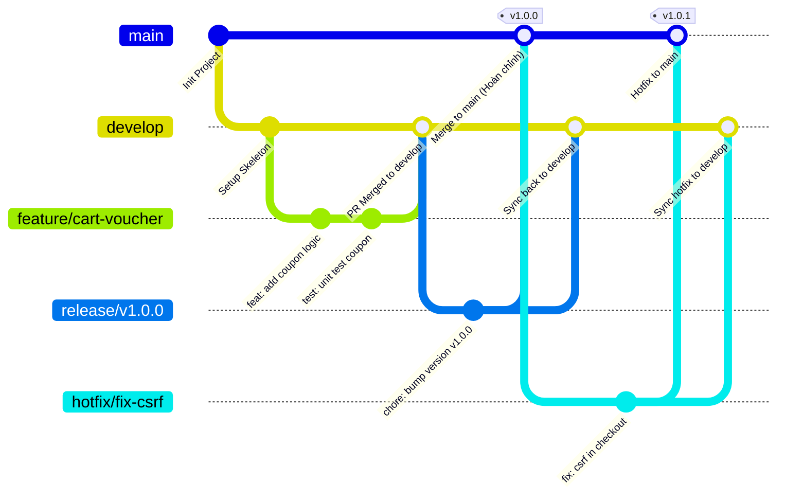

# WEBSITE THƯƠNG MẠI ĐIỆN TỬ QUỐC HÙNG MOBILE


---

## MỤC LỤC
1. [Giới thiệu dự án](#gioi-thieu-du-an)
2. [Cấu trúc thư mục và kiến trúc hệ thống](#cau-truc-thu-muc-va-kien-truc-he-thong)
3. [Yêu cầu hệ thống (Prerequisites)](#yeu-cau-he-thong-prerequisites)
4. [Hướng dẫn cài đặt và khởi chạy cục bộ (Local Setup)](#huong-dan-cai-dat-va-khoi-chay-cuc-bo-local-setup)
5. [Dữ liệu khởi tạo và phân quyền người dùng](#du-lieu-khoi-tao-va-phan-quyen-nguoi-dung)
6. [Quy trình làm việc nhóm theo mô hình Gitflow](#quy-trinh-lam-viec-nhom-theo-mo-hinh-gitflow)
7. [Các quy tắc và lưu ý sống còn khi làm việc với Git](#cac-quy-tac-va-luu-y-song-con-khi-lam-viec-voi-git)
8. [Xử lý các tình huống thường gặp (Troubleshooting)](#xu-ly-cac-tinh-huong-thuong-gap-troubleshooting)
9. [Hướng dẫn đẩy mã nguồn lên Git lần đầu (Initial Push)](#huong-dan-day-ma-nguon-len-git-lan-dau-initial-push)
10. [Thông tin liên hệ](#thong-tin-lien-he)

---

## GIỚI THIỆU DỰ ÁN

Dự án **Quốc Hùng Mobile** là website thương mại điện tử toàn diện dành cho bán lẻ thiết bị di động và sản phẩm công nghệ. Hệ thống không chỉ cung cấp giao diện mua hàng cho người tiêu dùng (B2C) mà còn tích hợp bộ công cụ quản trị nghiệp vụ nội bộ (Back-office management) mạnh mẽ:

* **Bán lẻ trực tuyến:** Duyệt danh mục, tìm kiếm, lọc theo cấu hình/màu sắc (biến thể sản phẩm), giỏ hàng thông minh, áp dụng mã giảm giá (coupon), đặt hàng và thanh toán.
* **Thanh toán linh hoạt:** Hỗ trợ thanh toán khi nhận hàng (COD) và thanh toán chuyển khoản qua mã **VietQR** động.
* **Đối soát thanh toán theo SLA:** Cơ chế đối soát giao dịch chuyển khoản ngân hàng tự động cảnh báo và chuyển cấp xử lý (Escalation) sau 12 giờ làm việc.
* **Quản lý kho hàng chuyên sâu:** Quản lý xuất/nhập/tồn kho theo từng biến thể sản phẩm, cơ chế giữ hàng tạm thời (reservation) khi đặt hàng và lịch sử điều chỉnh kho (inventory adjustment).
* **Trợ lý khách hàng tích hợp:** Chatbot trả lời câu hỏi thường gặp (FAQ Bot) tự động theo từ khóa và hộp thư hỗ trợ trực tuyến kết nối khách hàng với nhân viên tư vấn.
* **Phân quyền vai trò người dùng (RBAC):** Quản lý nghiêm ngặt quyền hạn theo 4 nhóm đối tượng: Khách hàng (Customer), Nhân viên bán hàng (Sales Staff), Nhân viên kho (Inventory Staff) và Quản trị viên (Admin).

---

## CẤU TRÚC THƯ MỤC VÀ KIẾN TRÚC HỆ THỐNG

Dự án được tổ chức theo mô hình phân tách ứng dụng độc lập (Django modular apps):

```text
Website Quốc Hùng Mobile/
├── .env.example                # File mẫu biến môi trường (copy thành .env để dùng)
├── .gitignore                  # Cấu hình bỏ qua các file không đưa lên Git
├── manage.py                   # Script quản lý chính của Django
├── requirements.txt            # Danh sách thư viện phụ thuộc của dự án
├── db.sqlite3                  # CSDL SQLite cục bộ (được bỏ qua bởi .gitignore)
│
├── config/                     # Cấu hình lõi của dự án Django
│   ├── settings.py             # Thiết lập ứng dụng, middleware, database, timezone...
│   ├── urls.py                 # Định tuyến URL cấp cao nhất của toàn hệ thống
│   ├── asgi.py & wsgi.py       # Cổng giao tiếp máy chủ web (Asynchronous & WSGI)
│   └── views.py                # Views chung của ứng dụng
│
├── accounts/                   # Quản lý người dùng, phân quyền RBAC & hồ sơ
│   ├── permissions.py          # Định nghĩa 4 vai trò nghiệp vụ và kiểm tra quyền
│   └── management/commands/    # Command khởi tạo nhóm quyền: setup_roles.py
│
├── catalog/                    # Danh mục, sản phẩm, thuộc tính & biến thể (Variant)
│   └── models.py               # Category, Product, ProductImage, Attribute, ProductVariant
│
├── inventory/                  # Quản lý kho hàng, nhập/xuất & đặt trước (Reservation)
│   ├── models.py               # InventoryItem, InventoryTransaction, InventoryReservation
│   └── services.py             # Nghiệp vụ trừ kho, giữ chỗ kho, hoàn trả kho
│
├── cart/                       # Giỏ hàng mua sắm của khách hàng
│   ├── services.py             # Xử lý thêm, sửa, xóa, tính tổng tiền giỏ hàng
│   └── context_processors.py   # Cung cấp số lượng giỏ hàng hiển thị trên Header (badge)
│
├── coupons/                    # Hệ thống mã giảm giá & khuyến mãi
│   ├── evaluation.py           # Thuật toán kiểm tra điều kiện áp dụng mã giảm giá
│   └── models.py               # Coupon, CouponUsage
│
├── orders/                     # Quy trình đặt hàng, xử lý đơn hàng & hủy đơn
│   ├── checkout_helpers.py     # Hỗ trợ checkout, tính toán chi phí, xử lý giỏ hàng
│   └── models.py               # Order, OrderItem, OrderHistory
│
├── payments/                   # Cổng thanh toán COD, VietQR & Đối soát SLA
│   ├── qr.py                   # Tạo mã VietQR động theo chuẩn Napas247
│   ├── sla.py                  # Thuật toán tính toán hạn chót đối soát 12 giờ làm việc
│   ├── services.py             # Nghiệp vụ xác thực thanh toán, hoàn tiền, escalation
│   └── management/commands/    # Lệnh quét đơn quá hạn: escalate_overdue_reconciliations.py
│
├── chat/                       # Chatbot hỗ trợ khách hàng & Hộp thư nhân viên
│   ├── models.py               # ChatFAQ, ChatConversation, ChatMessage
│   ├── services.py             # Xử lý tự động phản hồi từ khóa FAQ
│   └── management/commands/    # Lệnh nạp dữ liệu FAQ mẫu: seed_chat_faq.py
│
├── media/                      # Chứa file ảnh upload của sản phẩm (chỉ commit file .gitkeep)
├── static/                     # Tài nguyên tĩnh: CSS, JavaScript, Icons
│   └── css/                    # Giao diện cho auth, catalog, cart, chat, orders, inventory...
└── templates/                  # Giao diện HTML (Django Templates)
    ├── accounts/               # Màn hình đăng nhập, đăng ký, hồ sơ, quản lý nhân viên
    ├── catalog/                # Trang chủ, danh mục, chi tiết sản phẩm, form quản trị
    ├── cart/                   # Chi tiết giỏ hàng
    ├── orders/                 # Thanh toán (Checkout), chi tiết đơn, duyệt đơn
    ├── payments/               # Giao diện đối soát, xác nhận chuyển khoản
    ├── inventory/              # Danh sách kho, điều chỉnh kho, nhập kho
    ├── chat/                   # Widget chat khách hàng, Staff Inbox
    └── includes/               # Layout dùng chung (header, footer, sidebar)
```

---

## YÊU CẦU HỆ THỐNG (PREREQUISITES)

Trước khi bắt đầu, đảm bảo máy tính đã cài đặt các công cụ sau:

* **Python:** Phiên bản `3.12` hoặc `3.13` (Khuyến nghị 64-bit).
* **Git:** Phiên bản `2.30+`.
* **Trình quản lý gói:** `pip` phiên bản mới nhất.
* **Hệ điều hành:** Hỗ trợ tốt trên Windows 10/11, macOS và Linux.

---

## HƯỚNG DẪN CÀI ĐẶT VÀ KHỞI CHẠY CỤC BỘ (LOCAL SETUP)

Thực hiện tuần tự các bước dưới đây để thiết lập môi trường phát triển trên máy cá nhân:

### Bước 1: Tải mã nguồn về máy (Clone Repository)

```bash
# Clone repo từ Git remote (thay link repo tương ứng của nhóm bạn)
git clone <URL_REPO_CUA_NHOM>
cd "Website Quốc Hùng Mobile"
```

### Bước 2: Tạo và kích hoạt môi trường ảo (Virtual Environment)

> [!IMPORTANT]
> **Tuyệt đối KHÔNG cài đặt thư viện trực tiếp vào môi trường máy tính toàn cục (Global Python).** Hãy luôn tạo môi trường ảo riêng biệt `.venv` cho dự án.

* **Trên hệ điều hành Windows (PowerShell):**
  ```powershell
  python -m venv .venv
  .\.venv\Scripts\Activate.ps1
  ```
  *(Nếu gặp lỗi UnauthorizedAccess khi chạy script trên PowerShell, mở PowerShell bằng quyền Run as Administrator và gõ: `Set-ExecutionPolicy -ExecutionPolicy RemoteSigned -Scope CurrentUser`, sau đó kích hoạt lại).*

* **Trên Windows (Command Prompt - CMD):**
  ```cmd
  python -m venv .venv
  .\.venv\Scripts\activate.bat
  ```

* **Trên macOS / Linux:**
  ```bash
  python3 -m venv .venv
  source .venv/bin/activate
  ```

*(Khi kích hoạt thành công, bạn sẽ thấy tiền tố `(.venv)` xuất hiện ở đầu dòng lệnh).*

### Bước 3: Cài đặt các thư viện phụ thuộc

```bash
python -m pip install --upgrade pip
pip install -r requirements.txt
```

### Bước 4: Thiết lập file cấu hình môi trường (.env)

Tạo file `.env` bằng cách sao chép từ file mẫu `.env.example`:

* **Trên Windows (PowerShell):**
  ```powershell
  Copy-Item .env.example .env
  ```
* **Trên Linux / macOS:**
  ```bash
  cp .env.example .env
  ```

> [!NOTE]
> Mặc định file `.env.example` đã chứa các thiết lập phù hợp cho môi trường chạy thử nghiệm cục bộ (`DEBUG=True`, `SECRET_KEY` mẫu). Bạn có thể chỉnh sửa nếu cần.

### Bước 5: Khởi tạo Cơ sở dữ liệu (Migrations)

Thực hiện đồng bộ schema của các app vào cơ sở dữ liệu SQLite:

```bash
python manage.py migrate
```

### Bước 6: Nạp dữ liệu ban đầu và khởi tạo nhóm quyền

Hệ thống cung cấp các lệnh quản trị tự động phục vụ thiết lập nhanh môi trường phát triển:

1. **Khởi tạo 4 nhóm vai trò nghiệp vụ (RBAC):**
   ```bash
   python manage.py setup_roles
   ```
   *Lệnh này sẽ tự động tạo 4 nhóm: `Admin`, `Inventory Staff`, `Sales Staff`, `Customer`.*

2. **Nạp dữ liệu câu hỏi thường gặp cho Chatbot (FAQ Bot):**
   ```bash
   python manage.py seed_chat_faq
   ```
   *Lệnh này sẽ nạp sẵn các kịch bản câu hỏi thường gặp về giờ mở cửa, cách thanh toán VietQR, chính sách hủy đơn, đổi trả...*

3. **Tạo tài khoản Quản trị viên tối cao (Superuser):**
   ```bash
   python manage.py createsuperuser
   ```
   *(Nhập username, email và password theo hướng dẫn trên màn hình để tạo tài khoản đăng nhập vào trang quản trị).*

### Bước 7: Khởi chạy máy chủ phát triển (Development Server)

```bash
python manage.py runserver
```

Mở trình duyệt web và truy cập vào các địa chỉ sau:
* **Trang chủ cửa hàng:** [http://127.0.0.1:8000/](http://127.0.0.1:8000/)
* **Trang đăng nhập:** [http://127.0.0.1:8000/accounts/login/](http://127.0.0.1:8000/accounts/login/)
* **Trang quản trị Django Admin:** [http://127.0.0.1:8000/admin/](http://127.0.0.1:8000/admin/)

---

## DỮ LIỆU KHỞI TẠO VÀ PHÂN QUYỀN NGƯỜI DÙNG

Hệ thống xây dựng theo mô hình phân quyền theo vai trò (Role-Based Access Control):

| Nhóm vai trò (Role) | Phạm vi truy cập & Quyền hạn |
| :--- | :--- |
| **Customer** *(Khách hàng)* | Xem sản phẩm, quản lý giỏ hàng, đặt hàng, áp dụng coupon, theo dõi đơn hàng, gửi tin nhắn chat hỗ trợ, hủy đơn hàng (khi đủ điều kiện COD chưa giao). |
| **Sales Staff** *(Nhân viên bán hàng)* | Duyệt đơn hàng chờ xác nhận, kiểm tra đối soát thanh toán chuyển khoản VietQR, quản lý inbox chat hỗ trợ khách hàng, xem danh mục & sản phẩm. |
| **Inventory Staff** *(Nhân viên kho)* | Quản lý kho hàng, nhập kho sản phẩm, kiểm kê điều chỉnh số lượng tồn kho (Inventory Adjustment), xem lịch sử giao dịch kho. |
| **Admin** *(Quản trị viên)* | Toàn quyền cấu hình hệ thống: Quản lý danh mục & sản phẩm, cấu hình mã coupon, quản lý tài khoản nhân viên, xử lý các đơn hàng bị leo thang quá hạn (Escalation). |

---

## QUY TRÌNH LÀM VIỆC NHÓM THEO MÔ HÌNH GITFLOW

Để dự án phát triển mượt mà, hạn chế tối đa xung đột mã nguồn (merge conflicts) và đảm bảo chất lượng phần mềm, **tất cả thành viên trong nhóm bắt buộc phải tuân thủ nghiêm ngặt quy trình làm việc với Git** dưới đây.

### 1. Kiến trúc hệ thống các nhánh (Branching Strategy)

> [!IMPORTANT]
> **Nhánh `main` là NHÁNH CHÍNH (Primary & Default Branch) của toàn bộ dự án.**
> Nhánh `main` chứa toàn bộ mã nguồn đã hoàn chỉnh, ổn định nhất, đã qua kiểm tra nghiêm ngặt và sẵn sàng vận hành/triển khai.



* **`main` (Nhánh chính - Mã nguồn hoàn chỉnh):** 
  * Là nhánh mặc định (Default Branch) của repository.
  * Chứa toàn bộ mã nguồn **đã hoàn chỉnh**, ổn định và hoạt động chính xác.
  * **Tuyệt đối không commit hay code trực tiếp trên `main`.**
  * Mã nguồn chỉ được đưa vào `main` thông qua Pull Request (PR) đã được kiểm thử và phê duyệt từ các nhánh hoàn thiện (release, develop đã ổn định hoặc hotfix).
  * Mỗi lần cập nhật phiên bản trên `main` đều được gắn thẻ phiên bản (Git Tag: ví dụ `v1.0.0`, `v1.0.1`).

* **`develop` (Nhánh tích hợp & thử nghiệm):**
  * Nhánh tích hợp mã nguồn trong quá trình phát triển tính năng của các thành viên.
  * Đóng vai trò là nhánh đệm để kiểm tra sự tương thích giữa các chức năng trước khi đóng gói chuyển giao vào nhánh chính `main`.

* **`feature/<ten-tinh-nang>` (Nhánh phát triển tính năng mới):**
  * Được tách ra từ `develop` (hoặc `main` nếu nhóm phát triển theo mô hình rút gọn) để lập trình một tính năng cụ thể.
  * Sau khi hoàn thành và kiểm thử cục bộ, tạo Pull Request để merge lại vào `develop`.
  * *Ví dụ:* `feature/vietqr-auto-verify`, `feature/inventory-export-excel`.

* **`bugfix/<ten-loi>` (Nhánh sửa lỗi thông thường):**
  * Dùng để sửa các lỗi phát hiện trong quá trình kiểm thử tính năng trên môi trường phát triển.
  * Rẽ nhánh từ `develop` và merge về `develop`.

* **`release/<phien-ban>` (Nhánh đóng gói phát hành):**
  * Nhánh chuẩn bị chốt phiên bản khi các tính năng đã hoàn thiện.
  * Sau khi kiểm tra nghiệm thu lần cuối, nhánh này sẽ được merge chính thức vào nhánh chính `main` và đồng bộ ngược lại `develop`.

* **`hotfix/<ten-loi-khan-cap>` (Nhánh vá lỗi khẩn cấp):**
  * Nhánh xử lý các sự cố nghiêm trọng phát sinh trực tiếp trên nhánh chính `main`.
  * Rẽ nhánh trực tiếp từ `main`, sửa lỗi, sau đó merge trực tiếp vào `main` (gắn tag bản vá) và đồng bộ về `develop`.

---

### 2. Quy trình làm việc chi tiết từng bước cho từng thành viên

#### Bước 1: Cập nhật nhánh nền tảng mới nhất từ Remote
Trước khi bắt đầu thực hiện bất kỳ nhiệm vụ nào, luôn chuyển về nhánh làm việc cơ sở và kéo cập nhật mới nhất:
```bash
git checkout develop
git pull origin develop
```

#### Bước 2: Tạo nhánh tính năng mới
Đặt tên nhánh theo quy ước rõ ràng: `feature/<tên-ngắn-gọn-mô-tả-nhiệm-vụ>`:
```bash
git checkout -b feature/order-cancel-condition
```

#### Bước 3: Lập trình và kiểm thử cục bộ
* Viết mã nguồn sạch sẽ, tuân thủ đúng cấu trúc module của Django.
* Chạy thử nghiệm hệ thống trên máy cá nhân:
  ```bash
  python manage.py check
  python manage.py runserver
  ```
* Đảm bảo tính năng mới hoạt động chính xác và không gây lỗi cho các chức năng hiện có.

#### Bước 4: Commit mã nguồn theo chuẩn Conventional Commits
Viết thông điệp commit ngắn gọn, rõ ràng theo chuẩn quốc tế:
```bash
git status
git add <các_file_thay_đổi>
git commit -m "<type>(<scope>): <mô tả ngắn về thay đổi>"
```

**Các tiền tố (Type) quy định:**
* `feat:` Tính năng mới (ví dụ: `feat(orders): cho phep khach hang huy don COD cho xac nhan`)
* `fix:` Sửa lỗi (ví dụ: `fix(cart): sua loi tinh sai tong tien khi ap dung ma giam gia`)
* `docs:` Thay đổi tài liệu, README (ví dụ: `docs: cap nhat huong dan cai dat database`)
* `style:` Định dạng code, căn lề CSS/HTML không ảnh hưởng logic (ví dụ: `style(catalog): can chinh layout danh sach san pham`)
* `refactor:` Tái cấu trúc mã nguồn nhưng giữ nguyên nghiệp vụ (ví dụ: `refactor(payments): toi uu hoa thuat toan tinh SLA doi soat`)
* `test:` Thêm hoặc sửa test case (ví dụ: `test(coupons): bo sung test case ma giam gia het han`)
* `chore:` Cập nhật thư viện, cấu hình build, .gitignore (ví dụ: `chore: bo sung thu vien vao requirements.txt`)

#### Bước 5: Đồng bộ lại trước khi tạo Pull Request
Trong quá trình bạn làm việc, các thành viên khác có thể đã merge mã nguồn mới. Hãy luôn rebase để nhánh của bạn chứa các thay đổi mới nhất:
```bash
git checkout main
git pull origin main
git checkout feature/order-cancel-condition
git rebase main
```
*(Nếu có xung đột, giải quyết xung đột cục bộ theo hướng dẫn ở Mục 8, sau đó gõ: `git rebase --continue`).*

#### Bước 6: Đẩy nhánh lên Remote Repository
```bash
git push -u origin feature/order-cancel-condition
```

#### Bước 7: Mở Pull Request (PR) / Merge Request (MR) trên GitHub/GitLab
1. Chọn nhánh gốc nhận code (Base branch): `develop` (hoặc `main` nếu nhóm phát triển theo chu kỳ ngắn).
2. Chọn nhánh của bạn (Compare branch): `feature/order-cancel-condition`.
3. Điền thông tin PR đầy đủ:
   * Mục tiêu của thay đổi là gì?
   * Những màn hình/chức năng nào bị ảnh hưởng?
   * Đính kèm hình ảnh minh họa kiểm thử (nếu có giao diện).
4. **Chỉ định ít nhất 01 thành viên trong nhóm làm Reviewer (Code Review).**
5. **Điều kiện để Merge PR:**
   * Được Reviewer (To Uyen) phê duyệt (Approved).
   * Không có xung đột mã nguồn (No merge conflicts).
   * Ứng dụng chạy kiểm tra thành công.

#### Bước 8: Dọn dẹp nhánh sau khi Merge thành công
Sau khi Pull Request đã được merge:
```bash
git checkout develop
git pull origin main
# Xóa nhánh cục bộ đã hoàn thành
git branch -d feature/order-cancel-condition
# Xóa nhánh trên remote
git push origin --delete feature/order-cancel-condition
```

---

## CÁC QUY TẮC VÀ LƯU Ý SỐNG CÒN KHI LÀM VIỆC VỚI GIT

### 1. Những điều tuyệt đối cấm trong làm việc nhóm
* **Không bao giờ commit file `.env` hoặc để lộ Secret Key, mật khẩu, Token:**
  File `.env` chứa các thông tin bảo mật của hệ thống. Luôn dùng `.env.example` làm mẫu và đưa `.env` vào `.gitignore`.
* **Không bao giờ commit môi trường ảo `.venv/` hoặc thư mục cấu hình IDE (`.idea/`, `.vscode/`):**
  Thư mục này có dung lượng lớn, chứa đường dẫn tuyệt đối riêng của máy cá nhân và sẽ gây lỗi môi trường cho toàn bộ nhóm khi pull về.
* **Không bao giờ commit file cơ sở dữ liệu `db.sqlite3`:**
  File `db.sqlite3` là file nhị phân cục bộ. Khi nhiều người cùng commit, Git không thể tự merge nhị phân dẫn đến hỏng toàn bộ cơ sở dữ liệu hoặc ghi đè mất dữ liệu kiểm thử của đồng đội. Mọi người đều tự tạo DB riêng trên máy mình bằng lệnh `python manage.py migrate`.
* **Không bao giờ commit thư mục ảnh upload `media/*`:**
  Các file ảnh upload trong quá trình kiểm thử sẽ làm phình to repository rất nhanh. Chỉ commit file `media/.gitkeep` để giữ cấu trúc thư mục.
* **Cấm tuyệt đối lệnh `git push --force` (hoặc `git push -f`) lên các nhánh chung (`main`, `develop`):**
  Lệnh này sẽ ghi đè và xóa sạch toàn bộ lịch sử commit của các thành viên khác trên máy chủ Git.
* **Không lập trình trực tiếp trên nhánh `main` và `develop`:** Luôn tạo nhánh con để làm việc.

---

### 2. Quy tắc xử lý Django Migrations trong làm việc nhóm

Khi nhiều thành viên cùng chỉnh sửa `models.py` trên các nhánh khác nhau, việc đụng độ migration (Migration Conflict) là tình huống rất hay gặp. Quy tắc xử lý chuẩn:

* **Nguyên tắc 1: Luôn chỉ định rõ tên app khi tạo migration**
  Khi thay đổi model trong app nào, hãy chỉ định tên app đó:
  ```bash
  python manage.py makemigrations <ten_app>
  ```
  Kiểm tra kỹ file migration vừa sinh ra trong thư mục `<ten_app>/migrations/` trước khi commit.

* **Nguyên tắc 2: Cách giải quyết khi bị xung đột số thứ tự Migration (Conflicting Leaf Nodes)**
  Nếu bạn và đồng đội cùng tạo migration từ cùng một điểm xuất phát, khi kéo code về Django sẽ cảnh báo lỗi:
  ```text
  CommandError: Conflicting migrations detected; multiple leaf nodes in the migration graph: (0007_variant_sku, 0007_variant_barcode in catalog).
  To fix them run 'python manage.py makemigrations --merge'
  ```
  **Quy trình giải quyết chuẩn:**
  1. Chạy lệnh tự động tạo file hợp nhất của Django:
     ```bash
     python manage.py makemigrations --merge
     ```
  2. Django sẽ tạo ra một file migration hợp nhất (ví dụ: `0008_merge_...py`).
  3. Chạy `python manage.py migrate` để kiểm tra trên máy cá nhân.
  4. Commit cả file migration mới này lên Git để đồng đội cùng sử dụng.

* **Nguyên tắc 3: Tuyệt đối không xóa hay chỉnh sửa các file migration đã được merge vào `develop` hoặc `main`.** Mọi thay đổi về cấu trúc bảng sau đó phải được thực hiện thông qua file migration mới.

---

## XỬ LÝ CÁC TÌNH HUỐNG THƯỜNG GẶP (TROUBLESHOOTING)

### 1. Xử lý xung đột mã nguồn (Merge Conflict) khi Rebase hoặc Pull
Khi Git thông báo `CONFLICT (content): Merge conflict in ...`:
1. Mở các file bị conflict trong trình soạn thảo mã nguồn (VS Code, PyCharm).
2. Tìm các khối đánh dấu xung đột:
   ```text
   <<<<<<< HEAD (Mã nguồn hiện tại của nhánh đích)
   code của nhánh đích
   =======
   code của bạn thay đổi
   >>>>>>> feature/ten-nhanh
   ```
3. Trao đổi với thành viên cùng sửa đoạn code đó (nếu cần), chọn phần code chính xác nhất và xóa bỏ hoàn toàn các ký hiệu `<<<<<<<`, `=======`, `>>>>>>>`.
4. Lưu file và kiểm tra ứng dụng:
   ```bash
   python manage.py check
   python manage.py runserver
   ```
5. Đánh dấu đã giải quyết và tiếp tục quy trình:
   ```bash
   git add <cac_file_da_sua>
   git rebase --continue
   # (Hoặc gõ 'git commit' nếu bạn đang giải quyết conflict trong git merge)
   ```

### 2. Bỏ file ra khỏi vùng Staging khi thêm nhầm
```bash
# Bỏ file ra khỏi Staging (Unstage)
git restore --staged <ten_file>

# Hủy bỏ toàn bộ các thay đổi chưa commit trong file đó
git restore <ten_file>
```

### 3. Tạm cất công việc dang dở để chuyển nhánh khẩn cấp (`git stash`)
```bash
# Cất các thay đổi chưa commit vào bộ nhớ tạm
git stash save "Dang lam do tinh nang gio hang"

# Chuyển sang nhánh khác làm việc
git checkout develop

# Sau khi xong việc, quay lại nhánh cũ và lấy lại code
git checkout feature/my-feature
git stash pop
```

### 4. Lỗi múi giờ trên Windows (`ZoneInfoNotFoundError`)
Nếu gặp lỗi liên quan đến múi giờ `Asia/Ho_Chi_Minh` khi chạy dự án trên hệ điều hành Windows, hãy cài đặt thư viện `tzdata`:
```bash
pip install tzdata
```

---

## HƯỚNG DẪN ĐẨY MÃ NGUỒN LÊN GIT LẦN ĐẦU (INITIAL PUSH)

Dành cho Trưởng nhóm (Leader) hoặc người phụ trách khởi tạo Repository cho dự án:

```bash
# 1. Di chuyển vào thư mục dự án
cd "Website Quốc Hùng Mobile"

# 2. Khởi tạo Git repository (nếu chưa khởi tạo)
git init

# 3. Đặt nhánh chính là 'main'
git branch -M main

# 4. Kiểm tra trạng thái các file (đảm bảo .venv, db.sqlite3, media/* đã bị loại trừ bởi .gitignore)
git status

# 5. Đưa toàn bộ mã nguồn hoàn chỉnh đã chuẩn hóa vào Staging
git add .

# 6. Tạo Commit đầu tiên trên nhánh chính 'main'
git commit -m "feat: initial commit for Quoc Hung Mobile project on main branch"

# 7. Liên kết thư mục cục bộ với Git Remote trên GitHub/GitLab
git remote add origin <URL_REPO_TRÊN_GITHUB_HOẶC_GITLAB>

# 8. Đẩy nhánh chính 'main' (chứa code hoàn chỉnh) lên Remote
git push -u origin main

# 9. Tạo nhánh 'develop' từ nhánh chính 'main' để phục vụ tích hợp cho nhóm
git checkout -b develop
git push -u origin develop
```

Sau khi hoàn tất, trưởng nhóm vào phần **Settings > Branches** trên GitHub/GitLab:
1. Xác nhận **Default Branch là `main`** (Nhánh chính lưu trữ toàn bộ mã nguồn hoàn chỉnh).
2. Thiết lập chế độ bảo vệ nhánh (**Branch Protection Rules**) cho nhánh `main` (và `develop`):
   * Bật **Require a pull request before merging** (Không cho phép push trực tiếp vào `main`).
   * Bật **Require approvals** (Bắt buộc có tối thiểu 1 thành viên review và đồng ý trước khi merge vào `main`).

---

## THÔNG TIN LIÊN HỆ
* **Dự án:** Website Thương Mại Điện Tử Quốc Hùng Mobile
* **Phiên bản:** `1.0.0-dev`
* **Hỗ trợ kỹ thuật:** Mọi thắc mắc về mã nguồn hoặc quy trình làm việc với Git, vui lòng liên hệ Trưởng nhóm kỹ thuật để được hỗ trợ kịp thời.
